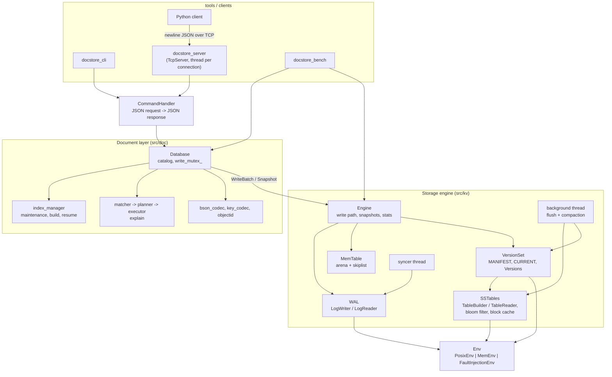
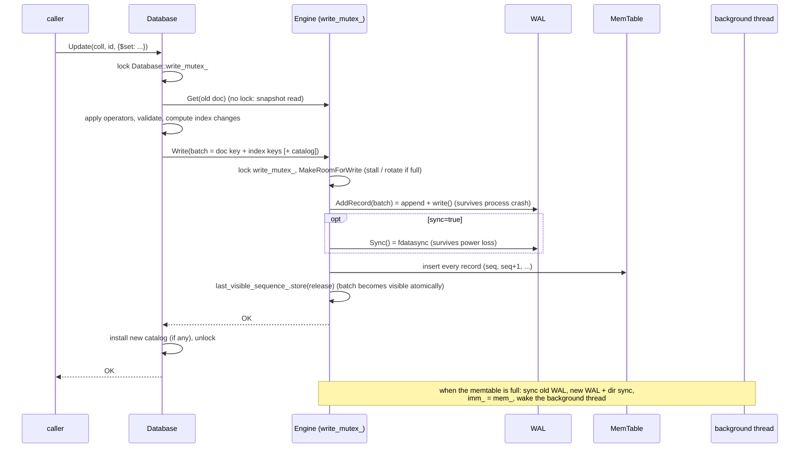
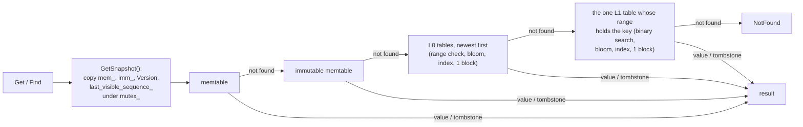
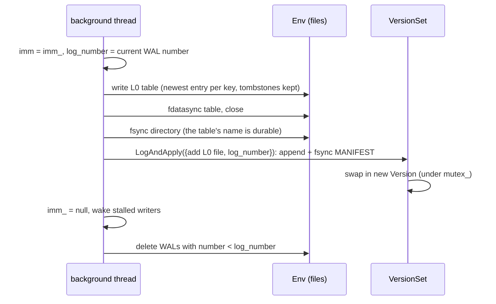
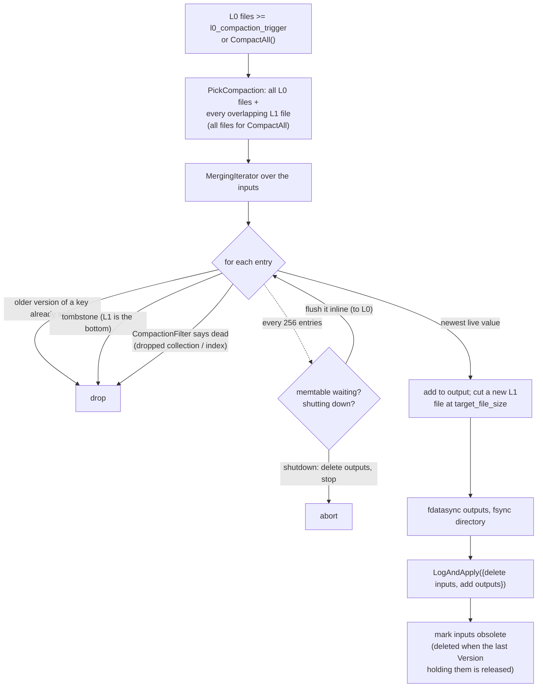
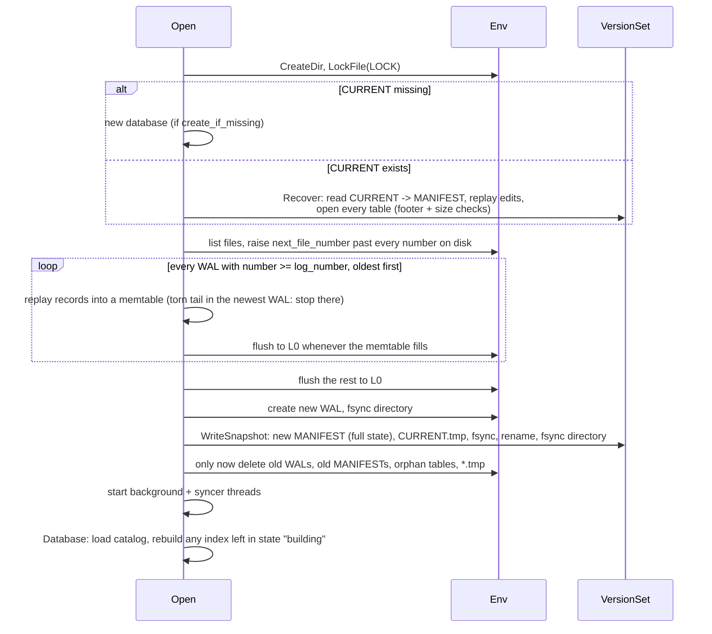
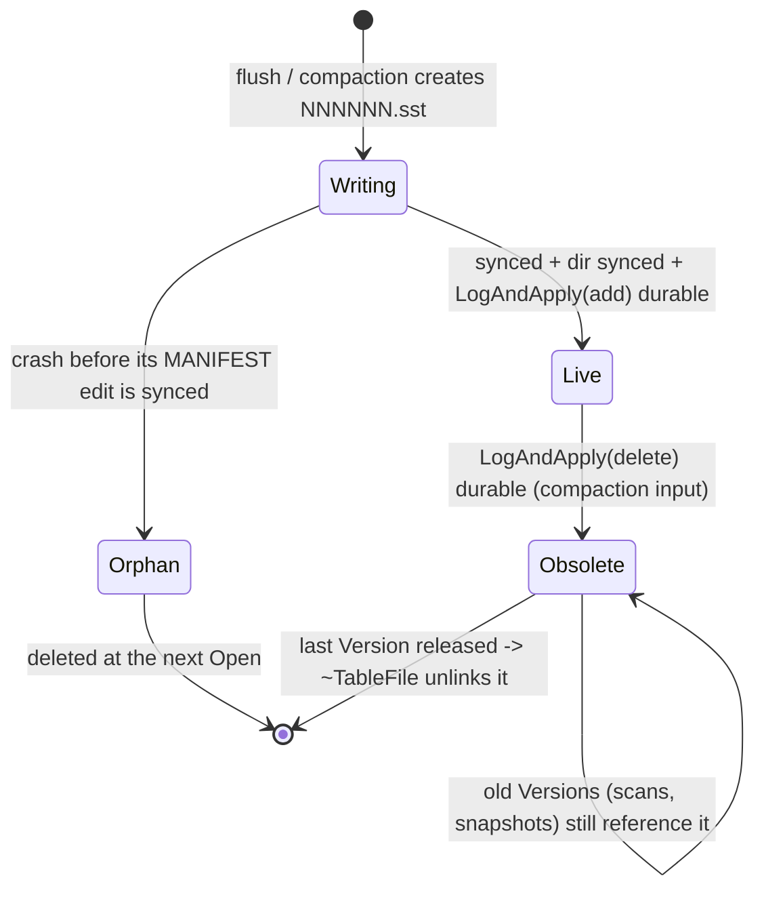

# DocStore architecture

## Components

## Write path

## Read path

Scans merge the same sources with a `MergingIterator` (min-heap) under a `DBIterator` that hides
entries newer than the snapshot, keeps the newest version per key, skips tombstones and applies
the `[lower, upper)` bounds. `Find` runs its whole plan (index scan + document fetches) on one
snapshot.

## Flush

## Compaction (L0 -> L1)

## Recovery (`Engine::Open`, then `Database::Open`)

## Table file lifecycle

